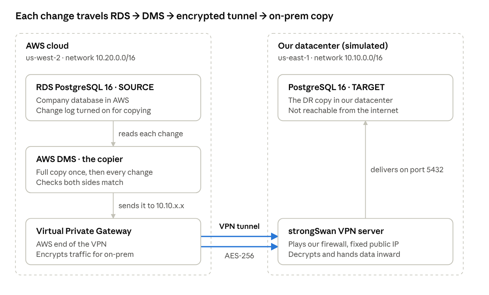

# DR Database Replication Lab: RDS PostgreSQL → on-prem VM over Site-to-Site VPN

This lab replicates an **Amazon RDS for PostgreSQL** database to a **PostgreSQL server in an on-premises datacenter**. **AWS DMS** does the replication: a full load first, then ongoing change data capture (CDC). The data travels over an **IPsec site-to-site VPN**.

There's no real datacenter here. A VPC in a second AWS region stands in for "on-prem", and a **strongSwan** EC2 instance plays the customer's VPN firewall.

## Why this exists

I built this with Nigeria's data localisation rules in mind:
- NITDA's ICT content guidelines, which require government data to be hosted locally;
- the NDPA 2023 and the NDPC's GAID 2025 on cross-border transfers;
- the CBN's June 2026 circular requiring payment data to be stored in Nigeria by 1 January 2027;
- the National Digital Cloud Policy adopted in August 2026.

Teams under these rules often end up hybrid, with some systems in AWS and certain data on infrastructure in Nigeria. That needs a private link and dependable replication between the two, which is what this lab rehearses.

It isn't legal advice, and it isn't a compliance solution on its own. Where the system of record, the backups and admin access sit still matters to a regulator.

## Architecture



```
 us-west-2  "cloud"  (10.20.0.0/16)                         us-east-1  "on-prem"  (10.10.0.0/16)
┌──────────────────────────────────────────┐              ┌──────────────────────────────────────────┐
│                                          │              │                                          │
│  RDS PostgreSQL 16  ── SOURCE            │              │  PostgreSQL 16 VM  ── TARGET             │
│   appdb, rds.logical_replication = 1     │              │   appdb (private subnet)                 │
│        │                                 │              │        ▲                                 │
│        ▼  logical replication slot       │              │        │                                 │
│  DMS replication instance                │              │        │  route 10.20.0.0/16 → strongSwan│
│   task: full-load-and-cdc                │              │        │                                 │
│        │  route 10.10.0.0/16 → VGW       │   IPsec x2   │  strongSwan EC2 (customer gateway)       │
│        ▼                                 │  (UDP 4500)  │   Elastic IP, vti1 / vti2                │
│  Virtual Private Gateway  ◄══════════════╪══════════════╪═►                                        │
│                                          │   Internet   │  NAT gateway (package installs)          │
└──────────────────────────────────────────┘              └──────────────────────────────────────────┘
```

Data path: **RDS → DMS → VGW → IPsec tunnel → strongSwan → PostgreSQL VM**

| Component | Site | Purpose |
|---|---|---|
| VPC + 2 public / 2 private subnets | both | Network per site. Non-overlapping CIDRs are required for VPN routing. |
| Virtual Private Gateway | cloud | AWS end of the VPN. Learned routes are propagated into the cloud route tables. |
| Customer Gateway + VPN Connection | cloud | Static routing, 2 tunnels, IKEv2 / AES-256 / SHA2-256 / DH14 |
| strongSwan EC2 + Elastic IP | on-prem | Plays the on-prem firewall. Route-based VPN (VTI) with tunnel 1 primary and tunnel 2 failover. |
| RDS PostgreSQL 16 | cloud | **Source** database. Logical replication enabled for CDC. |
| PostgreSQL 16 on EC2 | on-prem | **Target** database (the DR copy) |
| DMS replication instance + endpoints + task | cloud | Full load + CDC from RDS to the on-prem VM, with data validation |
| NAT gateway | on-prem | Lets the target VM install PostgreSQL |
| Test VM (optional) | cloud | Ping target for VPN tests |

## Repository layout

```
.
├── main.tf                    # wires all modules together
├── providers.tf               # aws.onprem (us-east-1) and aws.cloud (us-west-2)
├── variables.tf / outputs.tf / versions.tf
├── terraform.tfvars           # your settings (terraform.tfvars.example is a copy)
├── modules/
│   ├── vpc/                   # VPC, subnets, IGW, optional NAT, optional VGW
│   ├── vpn/                   # CGW, VPN connection, strongSwan appliance
│   │   └── templates/strongswan-userdata.sh.tftpl
│   ├── linux-vm/              # generic Amazon Linux 2023 VM with SSM access
│   ├── rds-postgres/          # source RDS + parameter group (logical replication)
│   ├── postgres-vm/           # target PostgreSQL VM (uses linux-vm)
│   │   └── templates/postgres-userdata.sh.tftpl
│   └── dms/                   # DMS IAM roles, replication instance, endpoints, task
└── sql/
    ├── seed-source.sql        # sample schema + data for RDS
    └── generate-changes.sql   # INSERT/UPDATE/DELETE to exercise CDC
```

## Prerequisites

- Terraform >= 1.5
- AWS CLI v2 with credentials for the target account
- [Session Manager plugin](https://docs.aws.amazon.com/systems-manager/latest/userguide/session-manager-working-with-install-plugin.html) for the AWS CLI (`aws ssm start-session`)
- `jq` (used in the commands below: `brew install jq`)

> **zsh gotcha (macOS default shell):** interactive zsh doesn't treat `#` as a comment, so a pasted line like `cmd   # note` passes `#` and `note` to `cmd` as arguments. Run `setopt interactivecomments` (add it to `~/.zshrc` to make it permanent), or leave out the trailing comments.

> **Region gotcha:** resources live in **us-east-1** (on-prem) and **us-west-2** (cloud). Your CLI default region may be different, so pass `--region` explicitly, and check the region selector in the console.

## Deploy

```bash
cp terraform.tfvars.example terraform.tfvars   # adjust if needed
terraform init
terraform apply
```

This takes about 20 minutes, mostly RDS and the DMS replication instance. Then seed the source database (see [Seeding the source](#seeding-the-source)), test the DMS endpoints, and start the task (see the verification steps below).

The DMS task is created **stopped** (`dms_start_task = false`) so you can test the endpoints first.

### Key variables

| Variable | Default | Notes |
|---|---|---|
| `onprem_region` / `cloud_region` | `us-east-1` / `us-west-2` | |
| `onprem_vpc_cidr` / `cloud_vpc_cidr` | `10.10.0.0/16` / `10.20.0.0/16` | Must not overlap |
| `onprem_enable_nat_gateway` | `true` | Needed for the target VM's package install |
| `cloud_enable_nat_gateway` | `false` | RDS and DMS need no internet |
| `postgres_version` | `16` | Same major version on source and target |
| `source_db_instance_class` | `db.t4g.micro` | |
| `target_db_instance_type` | `t3.micro` | |
| `dms_instance_class` | `dms.t3.small` | `dms.t3.micro` isn't offered in us-west-2 |
| `dms_create_iam_roles` | `true` | Set `false` if `dms-vpc-role` / `dms-cloudwatch-logs-role` already exist in the account |
| `dms_start_task` | `false` | Start manually after the endpoint tests pass |
| `enable_test_vms` | `true` | Ping target in the cloud VPC. You can turn it off once DMS works. |

---

## Verify it yourself

Run these from the repo directory. First, load the IDs from the Terraform outputs into shell variables:

```bash
export VPN_ID=$(terraform output -json vpn | jq -r .vpn_connection_id)
export SWAN_ID=$(terraform output -json vpn | jq -r .strongswan_instance_id)
export TARGET_VM=$(terraform output -json databases | jq -r .target.instance_id)
export RDS_HOST=$(terraform output -json databases | jq -r .source.host)
export DMS_RI=$(terraform output -json dms | jq -r .replication_instance_arn)
export DMS_TASK=$(terraform output -json dms | jq -r .replication_task_arn)
```

### 1. VPN tunnels are UP

From AWS's side:

```bash
aws ec2 describe-vpn-connections --region us-west-2 --vpn-connection-ids $VPN_ID \
  --query 'VpnConnections[0].VgwTelemetry[].[OutsideIpAddress,Status]' --output table
```

**Expected:** both tunnels show `UP`.

From the on-prem side, open a shell on the strongSwan instance:

```bash
aws ssm start-session --region us-east-1 --target $SWAN_ID
```
```bash
sudo ipsec statusall | grep -E 'ESTABLISHED|INSTALLED'   # 2x ESTABLISHED, 2x INSTALLED
ip route | grep 10.20                                    # 10.20.0.0/16 via vti1 (metric 100) and vti2 (metric 200)
```

Optional ping to the cloud test VM. Use `-I` so the reply comes back over the VPN:

```bash
ping -I $(hostname -I | awk '{print $1}') -c 3 <test_vm_cloud private_ip>
```

**Expected:** 0% packet loss, about 57 ms.

### 2. Cloud route tables learned the on-prem network

```bash
aws ec2 describe-route-tables --region us-west-2 --filters Name=tag:Site,Values=cloud \
  --query 'RouteTables[].Routes[?DestinationCidrBlock==`10.10.0.0/16`].[DestinationCidrBlock,GatewayId,State,Origin]' --output table
```

**Expected:** `10.10.0.0/16 → vgw-…`, `active`, `EnableVgwRoutePropagation`.

### 3. DMS can reach both databases

```bash
aws dms test-connection --region us-west-2 --replication-instance-arn $DMS_RI \
  --endpoint-arn $(terraform output -json dms | jq -r .source_endpoint_arn)
aws dms test-connection --region us-west-2 --replication-instance-arn $DMS_RI \
  --endpoint-arn $(terraform output -json dms | jq -r .target_endpoint_arn)

# wait ~30 s, then:
aws dms describe-connections --region us-west-2 \
  --filters Name=replication-instance-arn,Values=$DMS_RI \
  --query 'Connections[].[EndpointIdentifier,Status,LastFailureMessage]' --output table
```

**Expected:** both `successful`. The target test proves DMS (cloud) → on-prem VM on port 5432 works across the VPN.

### 4. Replication task is running and tables are validated

Start it if it isn't running yet:

```bash
aws dms start-replication-task --region us-west-2 --replication-task-arn $DMS_TASK \
  --start-replication-task-type start-replication
```

Status and per-table statistics:

```bash
aws dms describe-replication-tasks --region us-west-2 \
  --filters Name=replication-task-arn,Values=$DMS_TASK \
  --query 'ReplicationTasks[0].[Status,ReplicationTaskStats.FullLoadProgressPercent]' --output text

aws dms describe-table-statistics --region us-west-2 --replication-task-arn $DMS_TASK \
  --query 'TableStatistics[].[TableName,TableState,FullLoadRows,Inserts,Updates,Deletes,ValidationState]' --output table
```

**Expected:** `running 100`; both tables `Table completed` and `Validated`.

The same information is in the console: **DMS (us-west-2) → Database migration tasks → `dr-db-repl-rds-to-onprem` → Table statistics**.

### 5. Compare the data and watch CDC happen

Get the passwords on your machine:

```bash
terraform output -json db_passwords
```

Open a shell on the **on-prem PostgreSQL VM**. It can reach both databases: RDS through the VPN, and its own PostgreSQL locally.

```bash
aws ssm start-session --region us-east-1 --target $TARGET_VM
```

Inside the session:

```bash
sudo -i
export RDS_HOST=<databases.source.host from terraform output>
export PGPASSWORD='<db_passwords.source>'

# helper aliases: src = RDS (source, via VPN), tgt = local VM (target)
alias src='psql "host=$RDS_HOST dbname=appdb user=dbadmin sslmode=require"'
alias tgt='sudo -u postgres psql -d appdb'

Q="select count(*) as orders, sum(amount) as total, max(id) as max_id from orders"
src -c "$Q"
tgt -c "$Q"
```

**Expected:** identical rows on both.

Now make a change on the **source** and watch it appear on the **target**:

```bash
src -c "insert into orders (customer_id, amount) values (1, 123.45) returning id"
sleep 10
tgt -c "select * from orders order by id desc limit 3"     # the new row is here

src -c "update customers set country = 'GH' where id = 1"
sleep 10
tgt -c "select id, name, country from customers where id = 1"   # country = GH

src -c "delete from orders where id = (select max(id) from orders)"
sleep 10
src -c "$Q"; tgt -c "$Q"                                    # counts match again
```

Or run the bundled change script (10 inserts, 3 updates, 1 delete). Copy [sql/generate-changes.sql](sql/generate-changes.sql) to the VM, or paste its contents, then run `src -f generate-changes.sql`.

### 6. Prove the traffic really goes through the VPN

On the **target** VM, look at who's connected. The DMS replication instance appears with its **cloud private IP** (`10.20.x.x`). A private 10.20 address can only reach 10.10 through the tunnel.

```bash
tgt -c "select client_addr, application_name, state from pg_stat_activity where datname = 'appdb' and client_addr is not null"
```

On the **source** (RDS), you can see the logical replication slot DMS is reading from:

```bash
src -c "select slot_name, plugin, active, confirmed_flush_lsn from pg_replication_slots"
```

**Expected:** one slot, plugin `test_decoding`, `active = t`.

On the **strongSwan** instance, the tunnel packet counters go up while replication runs:

```bash
ip -s link show vti1
```

---

## Seeding the source

RDS can't run startup scripts, so the sample data is loaded from the on-prem VM (which also tests VM → RDS across the VPN). In a session on `$TARGET_VM`, with `src` defined as in step 5:

```bash
src -v ON_ERROR_STOP=1 -f seed-source.sql     # contents of sql/seed-source.sql
```

This creates `customers` (100 rows) and `orders` (1,000 rows). Every table has a primary key, which DMS needs to replicate UPDATEs and DELETEs.

## How the VPN works (short version)

- AWS always provisions **2 tunnels** per VPN connection. Both are configured.
- strongSwan uses **route-based VTI interfaces** (`vti1`, `vti2`). A route `10.20.0.0/16` with metric 100 via vti1 and 200 via vti2 gives automatic failover.
- The instance sits behind AWS's 1:1 NAT for its Elastic IP. strongSwan therefore uses NAT-Traversal (ESP in **UDP 4500**) and identifies itself as the Elastic IP (`leftid`).
- `source_dest_check = false` on the instance, plus `net.ipv4.ip_forward = 1`, lets it route traffic for other hosts.
- MTU 1419 + TCP MSS clamping avoid fragmentation problems inside the tunnel.
- Crypto is pinned to IKEv2 / AES-256 / SHA2-256 / DH group 14 on **both** sides: `modules/vpn/main.tf` locals and the template's `ike=` / `esp=`.

**Pre-shared keys:** VPC console (us-west-2) → Site-to-Site VPN → *Download configuration*, or `terraform state show module.vpn.aws_vpn_connection.this | grep preshared_key`, or `/etc/ipsec.secrets` on the strongSwan instance.

## Troubleshooting

| Symptom | Check |
|---|---|
| Can't find the instances | Wrong region selected. On-prem is us-east-1, cloud is us-west-2. |
| Tunnel DOWN | `sudo ipsec statusall` and `sudo journalctl -u strongswan-starter` on strongSwan. The SG must allow UDP 500/4500 from the tunnel IPs. |
| Ping from strongSwan fails, tunnel UP | Use `ping -I <strongSwan private IP>`. Otherwise the source is 169.254.x.x, which the cloud VPC can't route back. |
| DMS target test fails | Target VM SG and `pg_hba.conf` must allow `10.20.0.0/16`. Is `systemctl status postgresql` active on the VM? Tunnel UP? |
| DMS source test fails | RDS SG must allow `10.20.0.0/16`. The source endpoint needs `ssl_mode = require` (RDS PG 15+ forces SSL). |
| Task fails at CDC start | `show wal_level` on RDS must be `logical`. The parameter group needs `rds.logical_replication = 1`. |
| Updates/deletes not replicated | The table needs a primary key |
| Target VM has no PostgreSQL | `sudo tail -50 /var/log/cloud-init-output.log`. It needs the on-prem NAT gateway. |

## Limitations (lab, not production)

- DMS creates target tables with primary keys only. **Foreign keys, sequences/defaults and secondary indexes aren't created.** For real DR, create the schema on the target first (`pg_dump --schema-only`) and use `TargetTablePrepMode = TRUNCATE_BEFORE_LOAD` or `DO_NOTHING`.
- The DB users are superusers, for simplicity.
- Passwords and pre-shared keys are stored in the Terraform state, the instance user data and the DMS endpoints. **Don't commit `terraform.tfstate*`.** Use Secrets Manager for anything real.
- Single-AZ RDS, single-AZ DMS, a single strongSwan instance, static routing (no BGP).

## Cost and cleanup

Running cost is roughly **$4–5 / day**: RDS `db.t4g.micro`, DMS `dms.t3.small`, the VPN connection, one NAT gateway, 3× `t3.micro`, and an Elastic IP.

```bash
# stop replication first (a running task can block endpoint deletion)
aws dms stop-replication-task --region us-west-2 --replication-task-arn $DMS_TASK
terraform destroy
```

## Contributing

Issues and pull requests are welcome. Please run `terraform fmt -recursive` and `terraform validate` before opening a PR, and never include `terraform.tfstate` or real credentials.

## License

[MIT](LICENSE)
